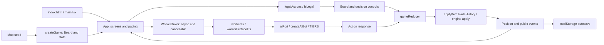

# Dardania code guide

Dardania is a seeded TypeScript settlement-and-trade engine, a React browser game and a set of CPU tools for training and measurement. The browser supports one human and two AI houses. The game contract is [docs/RULES.md](docs/RULES.md); measured results and their limitations are in [docs/EVALUATION.md](docs/EVALUATION.md).

## Start, build and test

Use Node 22 or newer from the repository root:

```sh
npm ci
npm run play
```

The production game is served at http://127.0.0.1:5173 after typechecking and building. `npm run dev` starts Vite development; `npm run build` writes `dist/`; `npm run play:lan` binds the production preview to all interfaces. Saves belong to the browser origin, so changing ports gives a separate save store.

```sh
npm run typecheck
npm test
npm run build
npm run smoke
```

Unit tests use four workers. Browser tests use one Chromium worker and start their own production preview on port 5178. Install Chromium with `npx playwright install chromium` if needed. To test an already running production server, set `DARDANIA_PLAY_BASE_URL=http://127.0.0.1:5173` before `npm run smoke`. Generated files under `node_modules/`, `dist/` and `runs/` are ignored.

## Execution and data flow

Browser execution starts at `index.html`; `src/ui/main.tsx` mounts `App.tsx`. Engine consumers start at the public exports of `src/engine/index.ts`, including `createGame(seed, players)`.



`App.tsx` selects screens and schedules decisions. `Board.tsx` draws SVG from immutable coordinates and supplied legal spatial choices. `PublicInfo.tsx` shows the Market and Stratagem row. `Chronicle.tsx`, `feedback.ts`, `places.ts` and `presentation.ts` turn public events into text, highlights and notices.

`src/ui/game.ts` owns the reducer and save format. Actual actions pass through `applyWithTradeHistory`, which delegates legality and mutation to engine `apply` and records public trade acceptances and decline reasons. Hypothetical search branches use ordinary engine `apply`. UI controls do not implement a second rule system.

`driver.ts` owns a lazily created module Web Worker. A decision returns a Promise; cancellation terminates pending computation, and the next request creates a fresh worker. Request IDs reject stale replies. `workerProtocol.ts` reconstructs typed state and caches the seeded map and independent bots. AI computation stays off the rendering thread.

The browser identifies human player ID zero independently of shuffled turn order. Each rival may offer to that person at most once during its own turn, even after a decline. Current-turn public events restore this offer flag after reload or worker restart. Accepted-trade guards use serialized public `aiTradeHistory`, rather than private worker memory. Ordinary all-bot tools have no human player; proxy arenas can explicitly rotate a human context.

## Engine contracts and saves

`Board` contains immutable land hexes, vertices, edges, coordinates, adjacency and graph distances. Other axial cells are sea. Map generation is deterministic and checks connectivity, terrain/token constraints and landmark spacing. Mutable state contains pieces, public holdings, cards, phases and execution streams.

`state.toAct` is the next decision maker; it can differ from `state.active` during discards and trade responses. Setup runs forward and then reverse through the player order. Turn zero is setup; subsequent turns count individual player turns. Surveyors and Warband decisions have explicit phases.

`legalActions` enumerates atomic choices except trade proposals. `isLegal` validates proposals, and `apply` checks every action before mutation and returns events. Clone state before exploring a branch. A forced roll can be passed as the fourth `apply` argument, directly or through `{ forcedTotal: total }`; this does not consume the execution RNG. `DICE_OUTCOMES` defines roll probabilities.

Goods buffers use Timber, Clay, Grain, Bronze, Horses order. Empty owners are `-1`. Hands and cards are player-major arrays; `freshCards` counts cards bought this turn. Deck and row live data end at `deckCount` and `rowCount`; unused tails are not cards. Quantities and costs live in `src/engine/config.ts`. Change that file, the printed Rules and literal contract tests together when changing balance.

Holdings are public; future dice and unseen deck order are private. AI inference clones state and calls `randomizeHidden`, replacing the future dice stream and canonically sorting then shuffling the unseen card multiset from its own seed. Visible holdings and row cards stay fixed. Cached plans are invalidated when newly revealed cards disagree with their predicted positions.

Autosaves use `dardania.save.v1` and preserve settings, actions, public events, pending notices, execution RNG and serialized state. Resume regenerates the map and restores typed buffers. Accepted-trade metadata survives cloning, saves and worker messages. Loading an older save validates its engine fingerprint first, then reconstructs trade history from individual current-turn event entries. It does not aggregate separate turns. New games and rematches start with fresh controller history.

`serializeState`, `deserializeState` and `stateHash` support restoration and replay checks. Fingerprints detect accidental corruption, not tampering. Their implementation may change; compare serialized positions across versions. Worker-private search streams are not saved. Encoding changes need a versioned save decoder.

## AI interfaces and policy

`src/ai/index.ts` exports `createAIBot(name, seed, overrides?)`, `TIERS` and search interfaces. Create one seeded bot per player. `chooseAction` is synchronous and browser-safe; the UI invokes it inside a worker. The UI imports this implementation through `aiPort.ts`, with no separate difficulty table.

`src/ai/tiers.ts` owns budgets, models, noise and trade thresholds:

| Tier | Main search | Model | Setup evaluations | Browser decision cap |
| --- | --- | --- | ---: | ---: |
| Astyanax | Greedy, 40% uniform random choices | W0 | 0 | Disabled |
| Paris | Planner, 128 nodes, noise 0.005 | W0 | 0 | Disabled |
| Aeneas | Planner, 128 nodes | Tuned checkpoint 4 | 0 | Disabled |
| Sarpedon | Planner, 4,096 nodes | Tuned checkpoint 4 | 2,048 | Disabled |
| Hector | Planner, 32,768 nodes | Tuned checkpoint 4 | 8,192 | 3,000 ms, cooperative |

All tiers disable next-roll lookahead. Epsilon/delta pairs are 0/0.08, 0/0.06, 0.001/0.015, 0.001/0.015 and 0.001/0.005 respectively. Default proposals are limited to two; no tier enables exhaustive active trading. Aeneas, Sarpedon and Hector enable the trade guards; the two weaker tiers retain their generous acceptance policy.

`features.ts` extracts 49 natural-unit features per player. `value.ts` applies shared coefficients and a softmax; player identity is not a feature. Terminal positions return exact winner probabilities. Nonterminal scores are search values, not calibrated win forecasts. `weights/w0.json` is the starting model; `weights/fitted.json` is the retained tuned model. Its metadata explains training and gate evidence.

`planner.ts` searches legal action sequences; `mcts.ts` provides an alternative search interface. `placement.ts` can forecast setup using a separate evaluation budget and seeded greedy future actors. Search values do not establish a strength gain without matched arena measurements. Build-deficit features optimize direct market purchases and may miss multi-hop conversions even when search can enumerate them.

`board-key.ts` keys private plan and offer caches by full immutable board contents and turn, preserving them across equivalent structured clones while invalidating changed maps. Create fresh bots even for rematches using the same seed. Trade proposals and responses live in `trade.ts`; guarded acceptance rejects immediate resource cycling and excessive proposer gains. Shared formatting displays four bounded decline explanations without exposing sampled futures. Two-offer checks are not a proof against all longer or mixed-policy cycles.

A positive `timeLimitMs` creates one shared `performance.now()` deadline across setup, search and proposals. The worker recovery retry receives only remaining time. Search retains a fully evaluated legal fallback; already expired responses decline. Individual bounded operations can finish after the deadline, so this is cooperative. Browser Hector uses the limit; fixed-work Node arenas, self-play and tuning explicitly disable it. Timing and strength under a clock are separate measurements.

## Retrain and tune

`tools/selfplay.ts` writes grouped game examples and generation metadata; `tools/fit.ts` fits shared coefficients using game-level holdouts, training-only RMS scales and optional sign constraints. These example commands create a fresh experiment, rather than reconstructing the retained tuning run:

```sh
npx tsx tools/selfplay.ts --tier Aeneas --games 5000 --seed 150000 --processes 4 --generation 0 --budget 128 --weights src/ai/weights/w0.json --active-trading false --trade-proposals 2 --delta 0.015 --eps 0.001 --out runs/training-g0
npx tsx tools/fit.ts --input runs/training-g0 --out runs/candidate.json --id candidate --weights src/ai/weights/w0.json --prior-weights src/ai/weights/w0.json --l2 1 --constrain-signs true
npx tsx tools/arena.ts --games 600 --seed 16000000 --processes 4 --challenger Aeneas --opponent Aeneas --challenger-weights runs/candidate.json --opponent-weights src/ai/weights/w0.json --out runs/candidate-vs-w0.csv
npx tsx tools/measure.ts runs/candidate-vs-w0.csv
```

Use disjoint directories and seeds for later generations; `--start` appends non-overlapping batches within a generation. Keep holdouts grouped by game. Failed candidates remain failures; fitting never installs browser weights automatically.

`tools/tune.ts` performs direct CEM win-rate search. It uses fixed common-seed candidate windows and separate checkpoint gates; restarting with the same seed is not fresh evidence. A non-W0 starting model requires matching passing arena evidence through `--start-gate`.

```sh
npx tsx tools/tune.ts --weights src/ai/weights/w0.json --scales-from runs/candidate.json --processes 4 --minutes 89 --out runs/tuning.json
```

Keep tuning and final measurement seeds separate. Preserve acceptance evidence before installing retained coefficients and rebuild afterward. See the evaluation for the retained model's gates, rejected fits and failed final strength target.

## Measure and reproduce

`tools/arena.ts` plays one challenger against two identical opponents, rotating its player ID as game index modulo three. Map seeds are the base plus game index. Counts divisible by three balance player IDs; randomized turn-order position is measured separately. It writes CSV, JSON summaries and decision timing samples. All capped games remain in the results.

```sh
npx tsx tools/arena.ts --games 600 --seed 17000000 --processes 4 --challenger Hector --opponent Aeneas --out runs/hector-vs-aeneas.csv
npx tsx tools/measure.ts runs/hector-vs-aeneas.csv
npm run sim -- --games 3000 --bots greedy,greedy,greedy --processes 4 --seed 10000
npm run bench
npx tsx tools/browser-timing.ts
npx tsx tools/trade-guard-cycle-check.ts
```

Arena options support each side's engine, budget, setup budget, weights and trade policy. Match all options and seeds when comparing the exhaustive `Trader` proposal proxy with its ordinary base, including `--human-challenger true` for both. `measure.ts` recounts saved CSVs without rerunning games. Baseline simulator results do not establish the strength of the five browser tiers.

The browser timing tool captures thirty naturally reached mid-game positions per tier in real Chromium module workers, with warmups, raw CSV, summary statistics, cancellation and frame responsiveness. Setup and UI pacing are excluded. Use an otherwise idle CPU for comparisons and record runtime settings. A small corpus does not establish a latency bound or clock-limited strength. The separate browser deadline test uses a dedicated interpreter-only Chromium runtime and compares equal budgets with the clock enabled and disabled.

`tools/trade-guard-cycle-check.ts` reads the shipped position corpus and tier configuration under `tests/fixtures/`, making its two-offer checks reproducible without another checkout. Inspect the evaluation for what those checks do and do not show.

After committing a local change on `main`, `tools/clean-clone-play.ts --scratch` accepts an explicit unused absolute scratch directory. It clones that public branch, installs dependencies and runs the exact production play command plus a real-bot DOM game. Port 5173 must be free. It records its checks under `runs/` and removes only the fresh scratch clone it created.

## Where to read next

| Path | Responsibility |
| --- | --- |
| `src/engine/board.ts`, `mapgen.ts` | Immutable graph and seeded maps |
| `src/engine/state.ts`, `actions.ts`, `rules.ts` | Mutable positions, atomic actions and legality |
| `src/engine/config.ts`, `docs/RULES.md` | Numerical rules and printed contract |
| `src/ai/` | Features, values, search, placement and trade policy |
| `src/ui/game.ts`, `driver.ts`, `workerProtocol.ts` | Saves, action application and worker lifecycle |
| `src/ui/App.tsx`, `Board.tsx` | Browser screens and map controls |
| `tests/` | Engine, AI, training, worker and browser contracts |
| `tools/` | Simulation, training, tuning, arenas and runtime measurement |

Function comments describe responsibilities and assumptions. Keep public boundaries small, pass data explicitly and update the guide alongside behavior changes.
