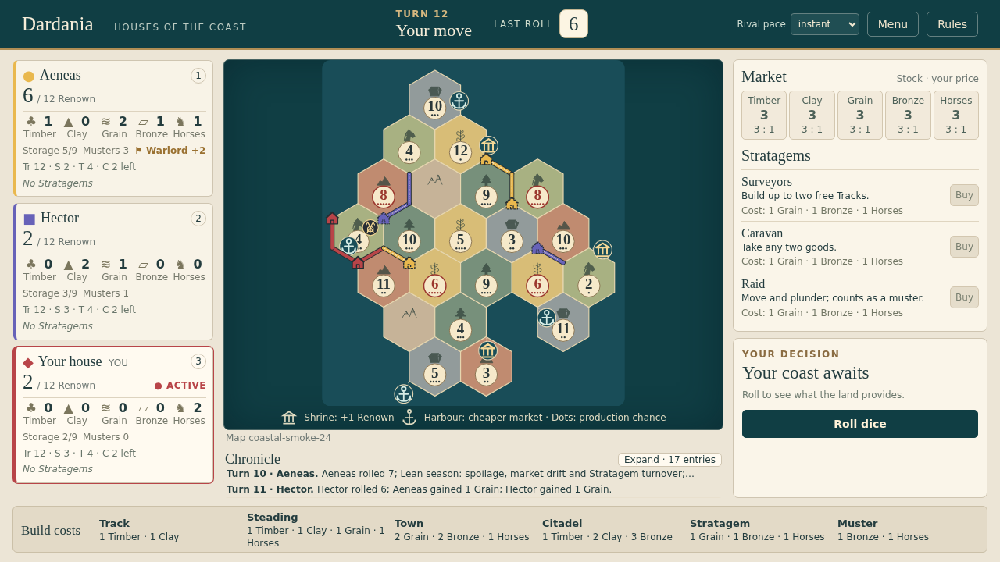

# Dardania

An original hex settlement-and-trade game for the browser: one person against two AI opponents, with five difficulty tiers. Build a house, gather goods, trade and compete for Renown.



With Node 22 or newer:

```sh
npm ci
npm run play
```

Open http://127.0.0.1:5173. Read the [rules](docs/RULES.md), [code guide](Human.md) and [evaluation](docs/EVALUATION.md).

Each arena places one challenger against two copies of its opponent. One-third is parity. Intervals are Wilson 95% intervals; the lower tiers have historical measurements with trade guards disabled, while the two upper rows use the current guarded policy.

| Challenger | Two opponents | Policy | Wins / games | Win rate | 95% interval |
| --- | --- | --- | ---: | ---: | ---: |
| Paris | Astyanax | Guards disabled | 528 / 600 | 88.00% | 85.16–90.36% |
| Aeneas | Paris | Guards disabled | 445 / 600 | 74.17% | 70.52–77.51% |
| Sarpedon | Aeneas | Current guards | 275 / 600 | 45.83% | 41.89–49.83% |
| Hector | Aeneas | Current guards | 259 / 600 | 43.17% | 39.26–47.16% |

Astyanax is the exploratory baseline. Larger search budgets do not establish a strict strength ranking. The top tier is only modestly stronger than the middle tier; the top two tiers are not separable in these results against the same opponents. There is no fresh guarded head-to-head comparison of those two tiers.

The first player won about 36% of a symmetric 3,000-game arena. A trade cycle through one of the two generous weak tiers remains possible. Strength with the browser time limit has not been measured: the arenas disable the clock, while browser Hector uses a cooperative three-second decision limit. See the evaluation for seed ranges, failed targets, tuning gates, timing conditions and the scope of the trade checks. `npm audit` reports advisories in development-only test tooling, and none in the production dependencies.

No licence has been chosen.
